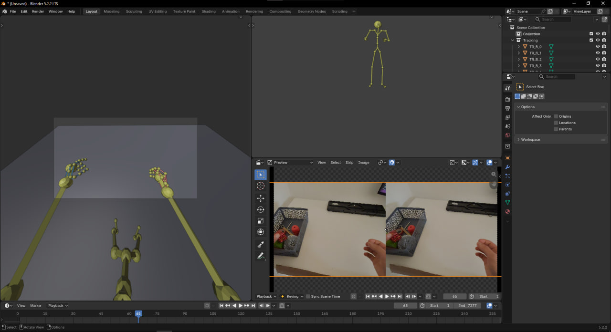

# Трекинг головы, рук и тела в Blender

Визуализация лога VR-трекинга (голова, две руки по 26 суставов, тело из 24 суставов) в 3D.
Экран разделён на три области: вид «из глаз» (камера в позиции головы), вид сбоку и оригинальное видео,
всё синхронно по одному таймлайну.

**Результат (видео):** [Google Drive](https://drive.google.com/file/d/1FpzIl7G3RP0YoK1SsIbLqrTDs74zhVi1/view?usp=sharing)



## Почему Blender

С Blender я немного знаком и знал, что в нём встроен Python (`bpy`). Поэтому рассчитывал, что лог
можно разобрать и использовать прямо внутри Blender, без отдельных программ и промежуточных конвертаций.
Так и получилось: один скрипт читает лог, строит сцену, подключает видео и раскладывает окно.
Blender к тому же сразу даёт 3D-вьюпорт, камеру и таймлайн, а результат можно записать как видео.

## Запуск

1. Blender 5.2 (проверено на 5.2.2). Номер версии важен: в 5.x у Sequencer своя привязка к сцене,
   скрипт её настраивает сам.
2. Положите рядом со скриптом (или в папку `data/`) файл лога `trackingData_*.txt` и видео
   (`.mp4`, `.mov` и т. п.).
3. Откройте Blender, вкладка **Scripting** → **Open** → `blender/tracking_viz.py` → **Alt+P**.
   При первом запуске лог разбирается (до минуты, окно может не отвечать) и сохраняется кэш `.npz`;
   дальше запуск быстрый.
4. Нажмите **пробел**.

Скрипт сам удаляет из сцены стартовые куб, камеру и свет, строит объекты и нарезает экран на три области.
Параметры (пути, fps, разрешение, сдвиг синхронизации) вынесены в блок `CONFIG` в начале файла.
Данные в репозиторий не включены (размер и содержимое), их нужно положить рядом со скриптом.

## Подход

Лог содержит около 21 800 записей (242 с, примерно 90 Гц). Каждая запись: поза головы, 26 суставов
каждой руки и 24 сустава тела. Я перевёл их в массивы numpy и сохранил в кэш.

В 3D-сцене: шар головы с «носом» (направление взгляда), суставы и кости рук и тела, пол. Камера
привязана к позе головы, так что видно то, что видел человек. Видео подключено в Video Sequencer.

Вместо keyframes на сотни объектов (это 77 объектов и десятки тысяч ключей, Blender стал бы
тормозить) используется обработчик смены кадра: он берёт нужную запись из массивов по реальному
времени `timeStampNs`. Сцена остаётся лёгкой, а трекинг (90 Гц) и видео (30 fps) совмещаются по
времени, а не по номеру кадра.

## Наблюдения

- В логе одна служебная строка: время первого кадра видео. Оно лишь на 18 мс раньше начала трекинга,
  то есть запись видео и трекинга стартовала практически одновременно.
- Тем не менее анимация опережала видео примерно на 0.2-0.3 с. Скорее всего, это задержка внутри
  устройства между съёмкой кадра и расчётом позы. Меток времени в логе для её учёта недостаточно,
  поэтому я подобрал сдвиг вручную по резким движениям в видео: `SYNC_SHIFT_S = -0.25` в `CONFIG` (трекинг сдвигается на 0.25 с назад).
- Левая рука отслеживается во всех записях, правая пропадает в 135 записях (около 1.5 с). В эти моменты
  её суставы скрываются.
- Начало координат лежит у гарнитуры, поэтому сцена поднимается так, чтобы низ скелета лежал на полу (Z=0).
- Оригинальное видео состоит из двух камер бок о бок, поэтому итоговый кадр сцены я зафиксировал
  в 16:9 (1920×1080), а видео в Sequencer вписывается с полосами.

## Сложности

- **Формат чисел.** Числа записаны с десятичной запятой и разделены запятыми
  (`"-0,085,-0,027,..."`). Приходилось склеивать токены попарно.
- **Системы координат.** В данных Y направлена вверх, в Blender вверх Z. Направление «вперёд»
  в документации не указано, поэтому скрипт определяет его автоматически по положению рук
  относительно взгляда головы.
- **Порядок суставов тела.** Описания формата не было. Порядок я предположил по стандартной
  схеме трекинга тела на 24 сустава, правильность проверил визуально: скелет выглядит как человек.
- **Blender 5.x.** У Sequencer теперь собственная сцена на уровне рабочего пространства: без её
  привязки область видео пустая. Скрипт привязывает основную сцену сам.

## Ограничения

- Обработчик кадров живёт только в текущей сессии Blender. После повторного открытия `.blend`
  скрипт нужно запустить заново (Alt+P).
- Повторный запуск в той же сессии нарезает экран ещё раз. Для чистой раскладки откройте Blender заново.
- Порядок суставов тела проверен только визуально, на одной записи.

## Как сделан этот проект

Скрипт написан с помощью Claude (Anthropic): я ставил задачу, выбирал подход и инструмент,
описывал, что и как хочу увидеть, и по результатам направлял правки (раскладка, камера, синхронизация,
формат кадра). Результат запускал и проверял в Blender сам.

## Структура

```
.
├── README.md
├── blender/
│   └── tracking_viz.py     # парсинг, сцена, камера, видео, раскладка экрана
├── data/                   # сюда кладётся лог и видео (в репозитории не хранятся)
└── media/
    └── preview.png         # скриншот результата
```
